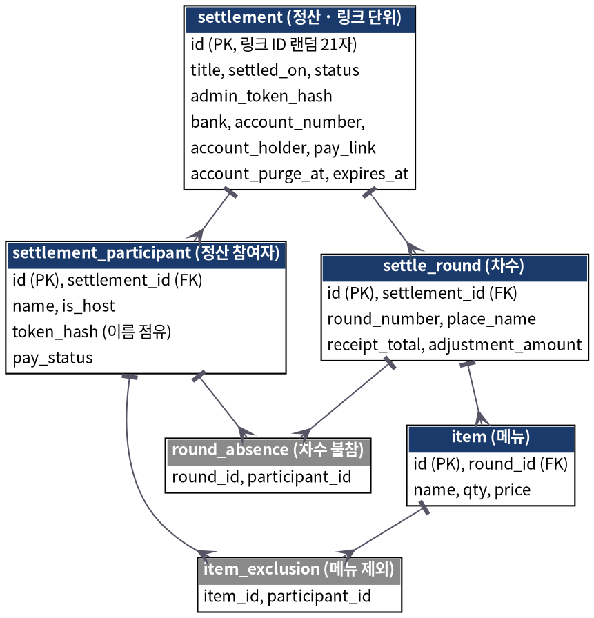

# 스냅 N빵 (Snap N-bbang)

영수증을 찍으면 AI가 메뉴를 읽고, 먹은 사람만 골라 나눠 계산한 뒤 링크로 공유하는 무로그인 모임 정산 서비스입니다.

## 핵심 기능
- 영수증 촬영·앨범 선택으로 AI가 메뉴와 금액 인식
- 차수(1차·2차) 누적, 메뉴별 제외, 인당 금액 실시간 계산
- 정산 링크를 카카오톡으로 공유, 참여자는 로그인 없이 내 몫 확인
- 송금 신고와 입금 확인(3단계), 한 화면 입금 현황

## 기술 스택
React (Vite) · Spring Boot · MyBatis · MySQL · Gemini API

## 폴더 구조
- frontend/ : React 웹앱
- backend/ : Spring Boot API
- db/schema.sql : MySQL 스키마
- docs/ : 기획서, 보안 설계, ERD

## 문서
- [프로젝트 기획서](docs/plan.pdf)
- [보안 설계 문서](docs/security.pdf)
- ERD: 

## 실행 방법
1. MySQL에 db/schema.sql 적용
2. backend/src/main/resources/application-local.yml 작성
   (필요한 이름: DB_URL, DB_USERNAME, DB_PASSWORD, GEMINI_API_KEY, GEMINI_MODEL, FRONTEND_ORIGIN)
3. 백엔드: cd backend && ./mvnw spring-boot:run -Dspring-boot.run.profiles=local
4. 프론트: cd frontend && npm install && npm run dev

## 진행 상황
- [x] 프로젝트 세팅, 백엔드 뼈대
- [ ] 프론트 뼈대
- [ ] 영수증 파싱, 정산 계산, 정산 API
- [ ] 화면 연결, PWA, 보안 마감

## 일정
1차 출시 2026-11-25 (PWA) · 2차: 모임 구조, 푸시 알림, 스토어 앱
